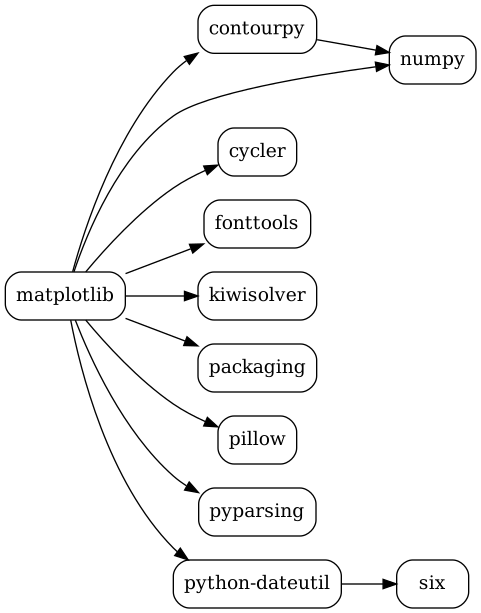
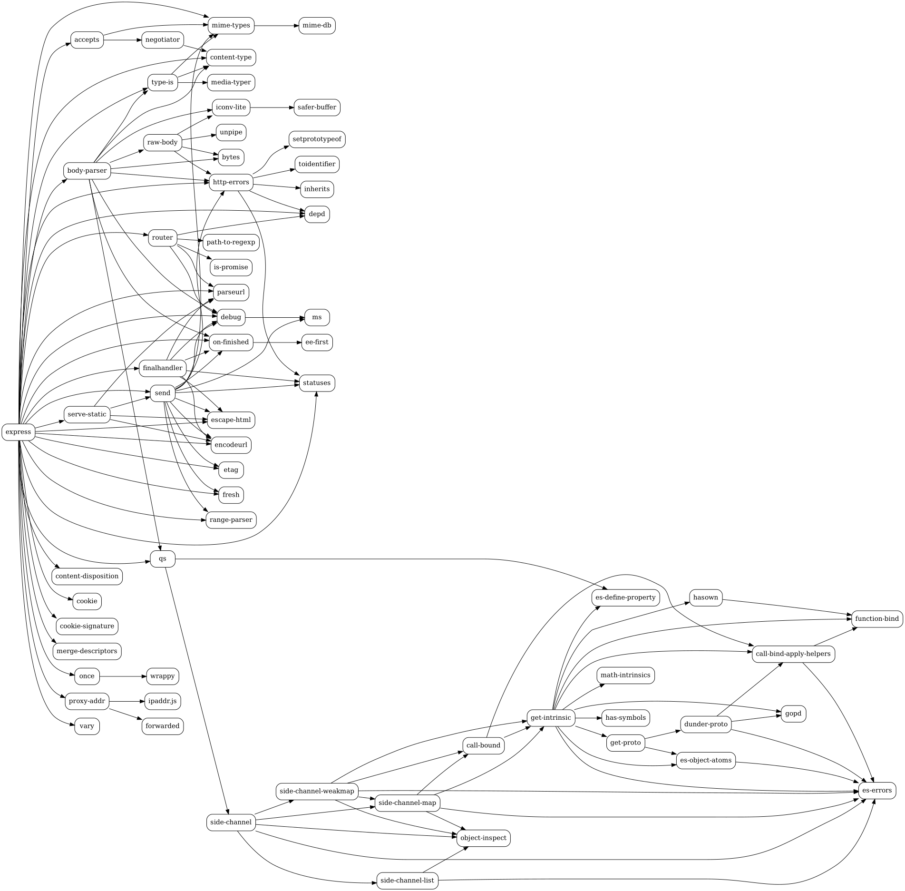

## Практическое занятие №2. Менеджеры пакетов

**Менеджер пакетов** — программа, которая скачивает, устанавливает, обновляет и удаляет пакеты, а главное — автоматически подбирает совместимые версии всех зависимостей.

**Пакет** — архив с кодом программы и файлом служебной информации (метаданными): имя, версия, автор, лицензия, список зависимостей с допустимыми версиями. В Python это `METADATA` в каталоге `*.dist-info`, в JavaScript — `package.json`.

**Semver** (семантическое версионирование) — версия вида `MAJOR.MINOR.PATCH`, например `2.4.1`:
- MAJOR — несовместимые изменения API;
- MINOR — новая функциональность с обратной совместимостью;
- PATCH — исправления ошибок.

Ограничения на версии:
- `^1.2.3` — `>=1.2.3 <2.0.0` (не меняется MAJOR);
- `~1.2.3` — `>=1.2.3 <1.3.0` (не меняется MINOR);
- `>=1.0.0`, `<2.0.0` — явные границы;
- `1.2.3` — ровно эта версия.

Программы со встроенным менеджером пакетов: Python (pip), Node.js (npm), Rust (cargo), Visual Studio Code (расширения), Sublime Text (Package Control), Emacs (package.el), Vim (vim-plug), LaTeX (tlmgr), R (`install.packages`), Blender (дополнения), Minecraft-лаунчеры (моды), Arduino IDE (Library Manager).

Все файлы с решениями лежат в папке [pract2](pract2).

## Задача 1

Вывести служебную информацию о пакете matplotlib (Python). Разобрать основные элементы содержимого файла со служебной информацией из пакета. Как получить пакет без менеджера пакетов, прямо из репозитория?

```
pip install matplotlib
pip show matplotlib
```

```
Name: matplotlib
Version: 3.11.2
Summary: Python plotting package
Home-page: https://matplotlib.org
Location: /usr/local/lib/python3.13/site-packages
Requires: contourpy, cycler, fonttools, kiwisolver, numpy, packaging, pillow, pyparsing, python-dateutil
Required-by:
```

Сам файл со служебной информацией находится в каталоге `matplotlib-3.11.2.dist-info`:

```
ls /usr/local/lib/python3.13/site-packages/matplotlib-3.11.2.dist-info
grep -E '^(Metadata-Version|Name|Version|Summary|Requires-Python|Requires-Dist|Project-URL)' /usr/local/lib/python3.13/site-packages/matplotlib-3.11.2.dist-info/METADATA
```

```
INSTALLER  LICENSE  METADATA  RECORD  REQUESTED  WHEEL

Metadata-Version: 2.1
Name: matplotlib
Version: 3.11.2
Summary: Python plotting package
Project-URL: Homepage, https://matplotlib.org
Project-URL: Source Code, https://github.com/matplotlib/matplotlib
Project-URL: Bug Tracker, https://github.com/matplotlib/matplotlib/issues
Requires-Python: >=3.11
Requires-Dist: contourpy>=1.0.1
Requires-Dist: cycler>=0.10
Requires-Dist: fonttools>=4.28.2
Requires-Dist: kiwisolver>=1.3.1
Requires-Dist: numpy>=1.25
Requires-Dist: packaging>=20.0
Requires-Dist: pillow>=9
Requires-Dist: pyparsing>=3
Requires-Dist: python-dateutil>=2.7
```

Основные элементы:
- `Metadata-Version` — версия формата метаданных;
- `Name`, `Version` — имя и версия пакета;
- `Summary` — краткое описание;
- `Project-URL` — ссылки на сайт, исходный код, баг-трекер;
- `Requires-Python` — подходящие версии Python;
- `Requires-Dist` — зависимости с ограничениями на версии;
- `LICENSE` — лицензия, `RECORD` — список установленных файлов с хешами, `WHEEL` — информация о формате архива.

Получить пакет без менеджера пакетов, прямо из репозитория:

```
git clone https://github.com/matplotlib/matplotlib.git
cd matplotlib
python3 -m build      # или просто скопировать каталог lib/matplotlib в проект
```

Также можно скачать архив `.tar.gz` / `.whl` вручную со страницы https://pypi.org/project/matplotlib/#files и распаковать его.

## Задача 2

Вывести служебную информацию о пакете express (JavaScript). Разобрать основные элементы содержимого файла со служебной информацией из пакета. Как получить пакет без менеджера пакетов, прямо из репозитория?

```
mkdir js && cd js
npm init -y
npm install express
npm view express
cat node_modules/express/package.json
```

```
name = 'express'
version = '5.3.0'
description = 'Fast, unopinionated, minimalist web framework'
license = 'MIT'
engines = { node: '>= 18' }
dependencies = {
  accepts: '^2.0.0',
  'body-parser': '^2.3.0',
  'content-disposition': '^2.0.1',
  'content-type': '^2.0.0',
  cookie: '^0.7.1',
  'cookie-signature': '^1.2.1',
  debug: '^4.4.0',
  ...
  'serve-static': '^2.2.0',
  statuses: '^2.0.1',
  'type-is': '^2.1.0',
  vary: '^1.1.2'
}
repository.url = 'git+https://github.com/expressjs/express.git'
```

Основные элементы `package.json`:
- `name`, `version` — имя и версия пакета (semver);
- `description` — описание;
- `license` — лицензия (MIT);
- `repository` — адрес репозитория с исходным кодом;
- `engines` — требуемая версия Node.js;
- `dependencies` — зависимости с ограничениями (`^` — совместимые версии);
- `devDependencies` — зависимости только для разработки (тесты и т.п.);
- `scripts` — команды (`npm test` и др.);
- `files` — какие файлы попадают в пакет.

Получить пакет без менеджера пакетов:

```
git clone https://github.com/expressjs/express.git
```

или скачать архив пакета прямо из реестра:

```
curl -L -o express.tgz https://registry.npmjs.org/express/-/express-5.3.0.tgz
tar xzf express.tgz
ls package
```

## Задача 3

Сформировать graphviz-код и получить изображения зависимостей matplotlib и express.

```
sudo apt install graphviz
nano deps2dot.py
```

```python
#!/usr/bin/env python3
import importlib.metadata as md
import json
import re
import subprocess
import sys


def python_deps(name, edges, seen):
    key = name.lower()
    if key in seen:
        return
    seen.add(key)
    try:
        reqs = md.requires(name) or []
    except md.PackageNotFoundError:
        return
    for r in reqs:
        if "extra ==" in r:          # необязательные (extras) зависимости пропускаем
            continue
        dep = re.split(r"[ ;<>=!~\[(]", r, maxsplit=1)[0]
        edges.add((key, dep.lower()))
        python_deps(dep, edges, seen)


def npm_deps(tree, name, edges):
    for dep, info in (tree.get("dependencies") or {}).items():
        edges.add((name, dep))
        npm_deps(info, dep, edges)


def to_dot(title, edges):
    lines = [f'digraph "{title}" {{', "  rankdir=LR;", "  node [shape=box, style=rounded];"]
    lines += [f'  "{a}" -> "{b}";' for a, b in sorted(edges)]
    lines.append("}")
    return "\n".join(lines)


if __name__ == "__main__":
    which = sys.argv[1]
    edges = set()
    if which == "matplotlib":
        python_deps("matplotlib", edges, set())
    else:  # express: дерево из `npm ls --all --json` в каталоге с установленным express
        tree = json.loads(subprocess.run(["npm", "ls", "--all", "--json"],
                                         capture_output=True, text=True, cwd=sys.argv[2]).stdout)
        npm_deps(tree["dependencies"]["express"], "express", edges)
    print(to_dot(which, edges))
```

```
python3 deps2dot.py matplotlib > matplotlib.dot
python3 deps2dot.py express js > express.dot
dot -Tpng matplotlib.dot -o matplotlib.png
dot -Tpng express.dot -o express.png
cat matplotlib.dot
```

```
digraph "matplotlib" {
  rankdir=LR;
  node [shape=box, style=rounded];
  "contourpy" -> "numpy";
  "matplotlib" -> "contourpy";
  "matplotlib" -> "cycler";
  "matplotlib" -> "fonttools";
  "matplotlib" -> "kiwisolver";
  "matplotlib" -> "numpy";
  "matplotlib" -> "packaging";
  "matplotlib" -> "pillow";
  "matplotlib" -> "pyparsing";
  "matplotlib" -> "python-dateutil";
  "python-dateutil" -> "six";
}
```

Зависимости matplotlib:



Зависимости express (полный граф, код в [express.dot](pract2/express.dot)):



## Задача 4

Изучить основы программирования в ограничениях. Установить MiniZinc, разобраться с основами его синтаксиса и работы в IDE.

Решить на MiniZinc задачу о счастливых билетах. Добавить ограничение на то, что все цифры билета должны быть различными (подсказка: используйте all_different). Найти минимальное решение для суммы 3 цифр.

Установка MiniZinc:

```
wget https://github.com/MiniZinc/MiniZincIDE/releases/download/2.9.3/MiniZincIDE-2.9.3-bundle-linux-x86_64.tgz
tar xzf MiniZincIDE-2.9.3-bundle-linux-x86_64.tgz
export PATH=$PWD/MiniZincIDE-2.9.3-bundle-linux-x86_64/bin:$PATH
minizinc --version
```

```
nano tickets.mzn
```

```
include "globals.mzn";
array[1..6] of var 0..9: d;
constraint all_different(d);
constraint d[1] + d[2] + d[3] = d[4] + d[5] + d[6];
var int: s = d[1] + d[2] + d[3];
solve minimize s;
output ["Билет: \(d), сумма трёх цифр = \(s)\n"];
```

```
minizinc tickets.mzn
```

```
Билет: [6, 2, 0, 4, 3, 1], сумма трёх цифр = 8
----------
==========
```

Минимальная сумма трёх цифр — 8 (меньше нельзя: нужно 6 разных цифр, а 0+1+2+3+4+5 = 15, значит сумма половины не меньше 8).

## Задача 5

Решить на MiniZinc задачу о зависимостях пакетов для рисунка.

Данные с рисунка:
- root 1.0.0 зависит от menu >=1.0.0 и icons 1.0.0;
- menu 1.1.0 – 1.5.0 зависят от dropdown ^2.0.0;
- menu 1.0.0 зависит от dropdown 1.8.0;
- dropdown 2.0.0 – 2.3.0 зависят от icons ^2.0.0;
- dropdown 1.8.0 и icons 1.0.0, 2.0.0 не имеют зависимостей.

```
nano task5.mzn
```

```
enum MENU = {menu_1_0_0, menu_1_1_0, menu_1_2_0, menu_1_3_0, menu_1_4_0, menu_1_5_0};
enum DROPDOWN = {dropdown_1_8_0, dropdown_2_0_0, dropdown_2_1_0, dropdown_2_2_0, dropdown_2_3_0};
enum ICONS = {icons_1_0_0, icons_2_0_0};

var MENU: menu;
var DROPDOWN: dropdown;
var ICONS: icons;

% root 1.0.0 -> menu >=1.0.0, icons 1.0.0
constraint icons = icons_1_0_0;
% menu 1.1.0..1.5.0 -> dropdown ^2.0.0
constraint menu >= menu_1_1_0 -> dropdown >= dropdown_2_0_0;
% menu 1.0.0 -> dropdown 1.8.0
constraint menu = menu_1_0_0 -> dropdown = dropdown_1_8_0;
% dropdown 2.x -> icons ^2.0.0
constraint dropdown >= dropdown_2_0_0 -> icons = icons_2_0_0;

solve maximize menu;   % как менеджер пакетов: берём самую свежую подходящую версию
output ["root 1.0.0\n\(menu)\n\(dropdown)\n\(icons)\n"];
```

```
minizinc task5.mzn
```

```
root 1.0.0
menu_1_0_0
dropdown_1_8_0
icons_1_0_0
----------
==========
```

Новые версии menu требуют dropdown 2.x, а он требует icons 2.0.0, что конфликтует с root (icons 1.0.0). Поэтому подходит только menu 1.0.0 + dropdown 1.8.0 + icons 1.0.0.

## Задача 6

Решить на MiniZinc задачу о зависимостях пакетов для следующих данных:

- root 1.0.0 зависит от foo ^1.0.0 и target ^2.0.0.
- foo 1.1.0 зависит от left ^1.0.0 и right ^1.0.0.
- foo 1.0.0 не имеет зависимостей.
- left 1.0.0 зависит от shared >=1.0.0.
- right 1.0.0 зависит от shared <2.0.0.
- shared 2.0.0 не имеет зависимостей.
- shared 1.0.0 зависит от target ^1.0.0.
- target 2.0.0 и 1.0.0 не имеют зависимостей.

```
nano task6.mzn
```

```
% версии кодируются как major*100 + minor*10 + patch; 0 = пакет не установлен
var {0, 100}: root;
var {0, 100, 110}: foo;
var {0, 100}: left;
var {0, 100}: right;
var {0, 100, 200}: shared;
var {0, 100, 200}: target;

constraint root = 100;
% root 1.0.0 -> foo ^1.0.0, target ^2.0.0
constraint root = 100 -> (foo >= 100 /\ foo < 200) /\ (target >= 200 /\ target < 300);
% foo 1.1.0 -> left ^1.0.0, right ^1.0.0
constraint foo = 110 -> (left >= 100 /\ left < 200) /\ (right >= 100 /\ right < 200);
% left 1.0.0 -> shared >=1.0.0
constraint left = 100 -> shared >= 100;
% right 1.0.0 -> shared <2.0.0
constraint right = 100 -> (shared > 0 /\ shared < 200);
% shared 1.0.0 -> target ^1.0.0
constraint shared = 100 -> (target >= 100 /\ target < 200);

solve maximize foo;
output ["root=\(root) foo=\(foo) left=\(left) right=\(right) shared=\(shared) target=\(target)\n"];
```

```
minizinc task6.mzn
```

```
root=100 foo=100 left=0 right=0 shared=0 target=200
----------
==========
```

Ответ: root 1.0.0, foo 1.0.0, target 2.0.0. Версия foo 1.1.0 не подходит: через right она требует shared 1.0.0, а тот — target ^1.0.0, что противоречит target ^2.0.0 у root.

## Задача 7

Представить задачу о зависимостях пакетов в общей форме. Получить описание пакетов и их зависимостей в виде словаря и построить систему ограничений автоматически, по метаданным.

```
nano solver.py
```

```python
#!/usr/bin/env python3
import subprocess
import sys

# Метаданные пакетов: имя -> версия -> {зависимость: ограничение semver}
PACKAGES = {
    "root":   {"1.0.0": {"foo": "^1.0.0", "target": "^2.0.0"}},
    "foo":    {"1.1.0": {"left": "^1.0.0", "right": "^1.0.0"},
               "1.0.0": {}},
    "left":   {"1.0.0": {"shared": ">=1.0.0"}},
    "right":  {"1.0.0": {"shared": "<2.0.0"}},
    "shared": {"2.0.0": {},
               "1.0.0": {"target": "^1.0.0"}},
    "target": {"2.0.0": {}, "1.0.0": {}},
}
ROOT = "root"


def parse(v):
    return tuple(int(x) for x in v.split("."))


def matches(version, spec):
    """Проверка версии на соответствие ограничению semver (^, ~, >=, <=, >, <, =)."""
    v = parse(version)
    for part in spec.split():          # несколько условий через пробел: ">=1.0.0 <2.0.0"
        if part.startswith("^"):
            b = parse(part[1:])
            upper = (b[0] + 1, 0, 0) if b[0] > 0 else (0, b[1] + 1, 0)
            ok = b <= v < upper
        elif part.startswith("~"):
            b = parse(part[1:])
            ok = b <= v < (b[0], b[1] + 1, 0)
        elif part.startswith(">="):
            ok = v >= parse(part[2:])
        elif part.startswith("<="):
            ok = v <= parse(part[2:])
        elif part.startswith(">"):
            ok = v > parse(part[1:])
        elif part.startswith("<"):
            ok = v < parse(part[1:])
        else:
            ok = v == parse(part.lstrip("="))
        if not ok:
            return False
    return True


def build_model(packages, root):
    """Каждый пакет — переменная 0..N, где 0 — «не установлен», i — i-я версия."""
    versions = {p: sorted(vs, key=parse) for p, vs in packages.items()}
    lines = []
    for p, vs in versions.items():
        lines.append(f"% {p}: " + ", ".join(f"{i + 1}={v}" for i, v in enumerate(vs)))
        lines.append(f"var 0..{len(vs)}: {p};")
    lines.append(f"constraint {root} > 0;")
    for p, vs in versions.items():
        for i, v in enumerate(vs, 1):
            for dep, spec in packages[p][v].items():
                ok = [str(j) for j, dv in enumerate(versions[dep], 1) if matches(dv, spec)]
                rhs = f"{dep} in {{{', '.join(ok)}}}" if ok else "false"
                lines.append(f"constraint {p} = {i} -> {rhs};  % {p} {v} -> {dep} {spec}")
    # пакет ставится, только если он кому-то нужен (как в настоящем менеджере)
    for p in versions:
        if p == root:
            continue
        users = [f"{q} = {i}" for q, qvs in versions.items()
                 for i, qv in enumerate(qvs, 1) if p in packages[q][qv]]
        need = " \\/ ".join(users) if users else "false"
        lines.append(f"constraint {p} > 0 -> ({need});")
    # среди допустимых решений выбираем наиболее свежие версии
    score = " + ".join(f"{p}" for p in versions)
    lines.append(f"solve maximize {score};")
    out = " ++ ".join(f'"{p}=" ++ show({p}) ++ "\\n"' for p in versions)
    lines.append(f"output [{out}];")
    return "\n".join(lines), versions


def main():
    model, versions = build_model(PACKAGES, ROOT)
    with open("generated.mzn", "w") as f:
        f.write(model + "\n")
    print(model, "\n")
    res = subprocess.run(["minizinc", "generated.mzn"], capture_output=True, text=True)
    if "UNSATISFIABLE" in res.stdout:
        print("Решения нет")
        sys.exit(1)
    print("Результат:")
    for line in res.stdout.splitlines():
        if "=" in line and not line.startswith(("-", "=")):
            p, i = line.split("=")
            i = int(i)
            print(f"  {p} {versions[p][i - 1] if i else '(не нужен)'}")


if __name__ == "__main__":
    main()
```

```
python3 solver.py
```

Автоматически построенная модель (`generated.mzn`) и результат:

```
% root: 1=1.0.0
var 0..1: root;
% foo: 1=1.0.0, 2=1.1.0
var 0..2: foo;
% left: 1=1.0.0
var 0..1: left;
% right: 1=1.0.0
var 0..1: right;
% shared: 1=1.0.0, 2=2.0.0
var 0..2: shared;
% target: 1=1.0.0, 2=2.0.0
var 0..2: target;
constraint root > 0;
constraint root = 1 -> foo in {1, 2};  % root 1.0.0 -> foo ^1.0.0
constraint root = 1 -> target in {2};  % root 1.0.0 -> target ^2.0.0
constraint foo = 2 -> left in {1};  % foo 1.1.0 -> left ^1.0.0
constraint foo = 2 -> right in {1};  % foo 1.1.0 -> right ^1.0.0
constraint left = 1 -> shared in {1, 2};  % left 1.0.0 -> shared >=1.0.0
constraint right = 1 -> shared in {1};  % right 1.0.0 -> shared <2.0.0
constraint shared = 1 -> target in {1};  % shared 1.0.0 -> target ^1.0.0
constraint foo > 0 -> (root = 1);
constraint left > 0 -> (foo = 2);
constraint right > 0 -> (foo = 2);
constraint shared > 0 -> (left = 1 \/ right = 1);
constraint target > 0 -> (root = 1 \/ shared = 1);
solve maximize root + foo + left + right + shared + target;

Результат:
  root 1.0.0
  foo 1.0.0
  left (не нужен)
  right (не нужен)
  shared (не нужен)
  target 2.0.0
```

Результат совпадает с решением задачи 6, но теперь ограничения строятся программой по словарю метаданных, как в настоящем менеджере пакетов. Чтобы решить другую задачу (например, задачу 5), достаточно заменить словарь `PACKAGES`.
